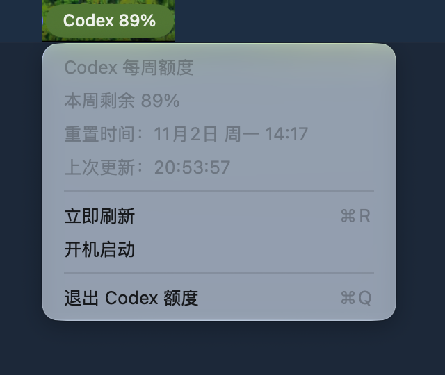

# Codex Quota Menu Bar

Consultez votre **quota hebdomadaire Codex restant** dans la barre des menus de macOS, comme le pourcentage de batterie. Application native en Swift et AppKit, sans bibliothèque tierce.

[English](README.md) · [简体中文](README.zh-CN.md) · [Français](README.fr.md) · [Deutsch](README.de.md)



## Démonstration

https://github.com/user-attachments/assets/a06aa77e-f319-4634-bfe9-c256333c639c

Capture de l’application macOS en fonctionnement : ouverture du menu, actualisation et consultation de l’heure de réinitialisation. Le fond est isolé ; les valeurs correspondent au moment de l’enregistrement.

[Télécharger la vidéo MP4](docs/media/demo.mp4)

L’interface de l’application est actuellement en chinois. La documentation est disponible en anglais, chinois, français et allemand. Ce projet open source est indépendant.

## Télécharger et installer

1. Téléchargez `Codex-Quota-v1.0.0-macos-arm64.zip` depuis les [versions publiées](https://github.com/criller/codex-quota-menubar/releases/latest).
2. Décompressez l’archive et placez `Codex Quota.app` dans Applications ou dans votre dossier personnel `~/Applications`.
3. Ouvrez l’application dans le Finder. La barre des menus affiche `Codex …` pendant le chargement, puis le pourcentage restant.

**Configuration requise :** Mac avec puce Apple Silicon (M1 ou ultérieure), macOS 14 ou ultérieur et installation locale de Codex connectée à un compte ChatGPT. Le binaire fourni est uniquement arm64. La compilation et la lecture du quota réel ont été vérifiées sur Apple Silicon avec macOS 27. Les versions antérieures de macOS n’ont pas toutes été testées.

L’application possède une signature ad hoc, sans signature Apple Developer ID ni notarisation. macOS peut bloquer le premier lancement. Vérifiez la provenance du téléchargement, puis suivez les instructions d’autorisation du système, ou compilez le code source.

## Fonctionnalités

- Affichage du quota hebdomadaire restant directement dans la barre des menus.
- Actualisation toutes les cinq minutes, nouvelle tentative chaque minute en cas d’échec et actualisation après la sortie de veille.
- Actualisation manuelle, heure de réinitialisation dans votre fuseau horaire et heure de la dernière mise à jour.
- Ajout de `!` à une ancienne valeur après un échec, dix minutes sans mise à jour réussie ou l’expiration de la période de quota.
- Affichage de `Codex --` si aucun quota n’a pu être lu. Une donnée absente n’est jamais considérée comme un quota restant de 100 %.
- Lancement facultatif à l’ouverture de session, désactivé par défaut.

Le pourcentage correspond au quota hebdomadaire du compte, **pas à un nombre de tokens restants**. L’application ne modifie pas le quota et ne déclenche pas sa réinitialisation.

## Fonctionnement et données

L’application démarre brièvement un processus local `codex app-server --stdio`. Après l’échange `initialize` / `initialized`, elle appelle uniquement `account/rateLimits/read`, puis ferme le processus.

Votre installation de Codex gère l’authentification et les requêtes réseau. L’application utilise la connexion Codex locale par défaut. Elle ne lance aucune génération par un modèle, ne lit pas les conversations et ne copie pas les identifiants d’authentification. Le projet n’exploite aucun serveur. Une clé API OpenAI seule ne donne pas accès au quota d’un abonnement ChatGPT.

L’application cherche le binaire Codex fourni avec ChatGPT/Codex, puis les installations Homebrew, `~/.local/bin` et nvm. Elle reconnaît la période de sept jours grâce à `windowDurationMins == 10080`, dans primary ou secondary. Elle privilégie `rateLimitsByLimitId.codex` et accepte l’ancien champ `rateLimits`. Le pourcentage restant est `100 - usedPercent`, arrondi à l’entier inférieur.

Référence : [protocole OpenAI Codex App Server](https://learn.chatgpt.com/docs/app-server). Une modification de l’authentification, des chemins d’installation ou du protocole peut nécessiter une mise à jour.

## Compiler le code source

Installez les outils de ligne de commande de macOS et une chaîne de compilation prenant en charge Swift 5.9 ou ultérieur.

```bash
git clone https://github.com/criller/codex-quota-menubar.git
cd codex-quota-menubar
bash build.sh
```

Le résultat se trouve dans `dist/Codex Quota.app`. Le script exécute les tests de régression essentiels, compile l’application arm64, puis applique et vérifie une signature ad hoc.

Pour vérifier la lecture du quota sans ouvrir l’interface :

```bash
"dist/Codex Quota.app/Contents/MacOS/CodexQuota" --check
```

Cette commande utilise le même client que la barre des menus et affiche uniquement le pourcentage restant et l’heure de réinitialisation. Ne publiez pas de fichiers d’authentification ni de journaux Codex non vérifiés dans les issues publiques.

Pour créer l’archive de distribution et sa somme de contrôle SHA-256 :

```bash
bash package.sh
```

Pour vérifier un téléchargement, dans le dossier contenant le ZIP et `SHA256SUMS.txt` :

```bash
shasum -a 256 -c SHA256SUMS.txt
```

## Dépannage

- **Codex introuvable :** installez ou mettez à jour Codex sur votre Mac. Un binaire compatible avec `app-server` doit être disponible.
- **Connexion requise :** connectez-vous à Codex avec votre compte ChatGPT, puis actualisez.
- **`!` ou `Codex --` :** consultez l’erreur et l’heure de mise à jour dans le menu, vérifiez votre connexion, puis réessayez.
- **Lancement à l’ouverture de session en attente :** autorisez l’application dans les réglages des éléments d’ouverture de macOS.

## Désinstaller

Désactivez le lancement à l’ouverture de session dans le menu, quittez l’application, puis supprimez `Codex Quota.app`.

## Licence

[MIT](LICENSE) © 2026 criller
